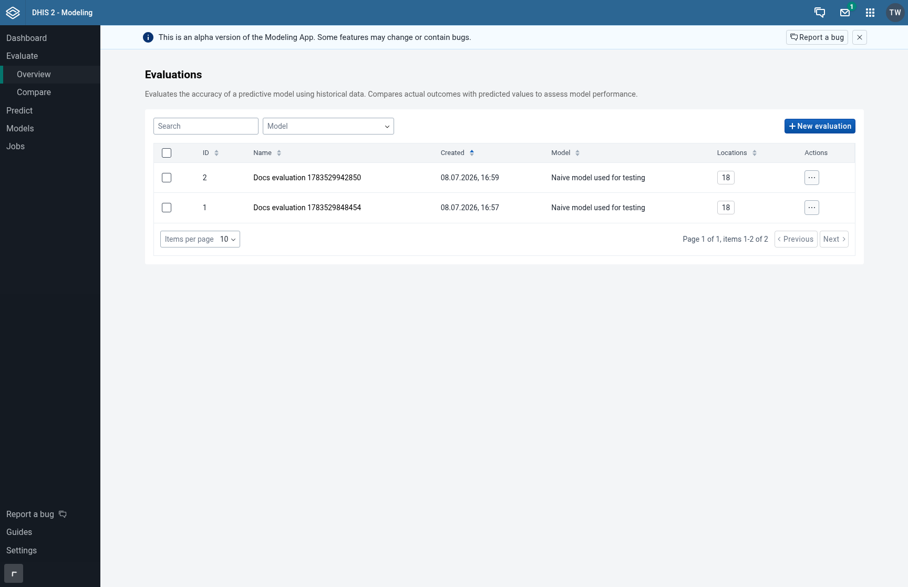
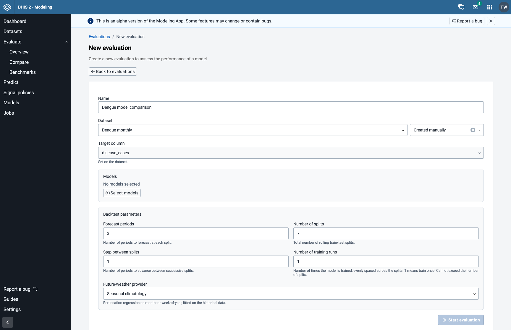
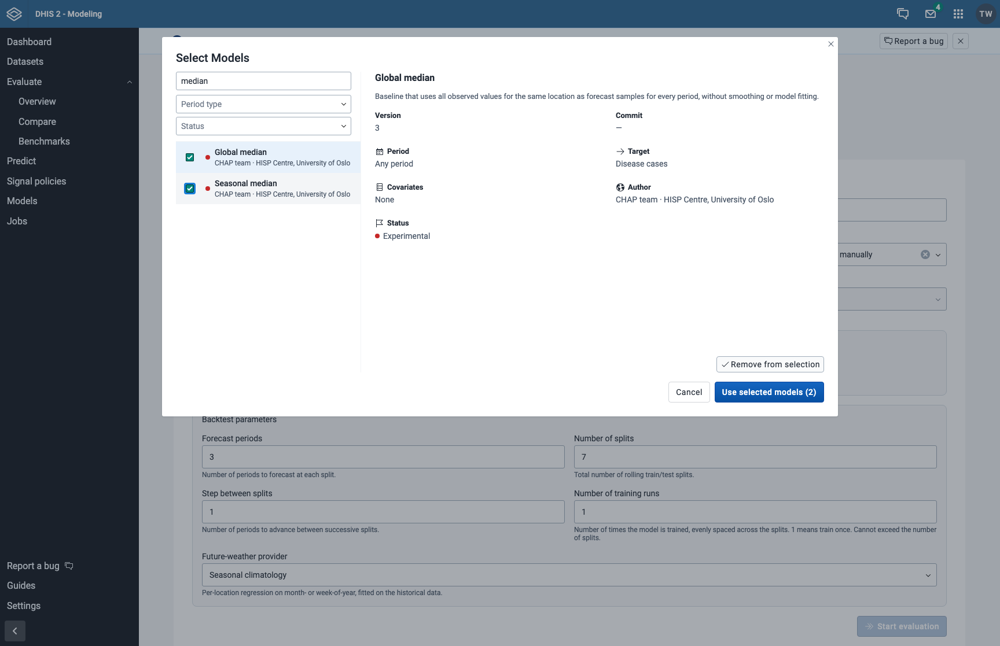

## Creating an Evaluation

An evaluation tests how accurately a predictive model performs using historical data. It compares actual outcomes with predicted values across time periods and locations, helping you assess the model before using it for forecasting.

Evaluations use saved datasets. If you have not imported your data yet, follow [Creating a dataset](/guides/creating-a-dataset) first. You can reuse the same dataset to compare several models on exactly the same data.

### Step 1: Open New Evaluation

Click **Evaluate** in the sidebar, then **New evaluation**.

You can also open the **⋯** menu in a row on the **Datasets** page and choose **New evaluation**, which pre-selects that dataset. The same action is available after creating a dataset.

### Step 2: Choose a Dataset

Enter a descriptive **Name** for the evaluation, then select a **Dataset**. By default, the origin filter lists datasets created on the Datasets page. Change the filter to find datasets created by earlier evaluations or predictions.

**Target column** shows the column the models predict and are scored against.

If there are no saved datasets, click **New dataset** to import one first. The dataset determines the periods, organisation units and data sources; create a new dataset if you need to change them.

### Step 3: Choose Models and Start the Evaluation

Click **Select models**. Only configured models compatible with the dataset's columns and period type are listed. Choose one or more models, then click **Use selected models**.

Under **Backtest parameters**, you can adjust the number of forecast periods, splits, the step between splits, the number of training runs and the future-weather provider. The fields start from the weekly or monthly [modeling defaults](/guides/settings) matching the dataset's period type. A notice appears if the dataset is too short or the forecast horizon is incompatible with a selected model.

Click **Start evaluation**. A background job is queued for each selected model, and you are taken to the **Jobs** page to monitor progress.

### Copy an Existing Evaluation

On the evaluation details page, click **Create new based on...**. You can also choose **Create new...** from an evaluation's **⋯** menu in the evaluations table.

Choose whether to copy the **Name**, **Dataset** and **Model**, then click **Create**. The new evaluation form opens with those selections. Review the backtest parameters before starting the new evaluation; they use the current modeling defaults.

### Next Steps

After the evaluation completes, you can:

- [View detailed results](/guides/viewing-evaluation-results) and metrics on the evaluation details page
- [Compare evaluations](/guides/comparing-evaluations) to find the best model configuration
- [Create a prediction](/guides/creating-a-prediction) with a validated model
