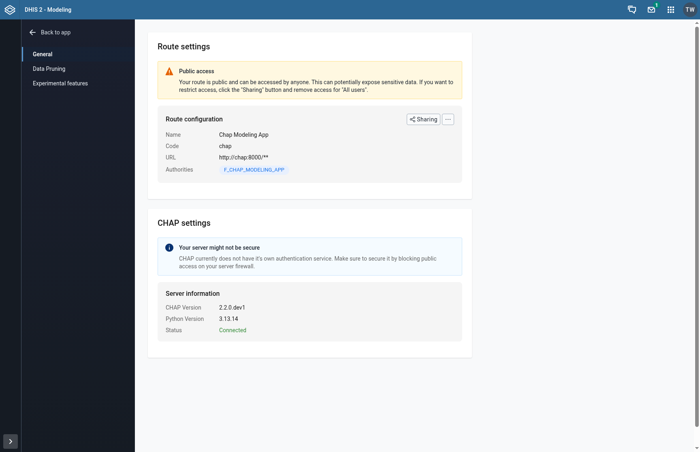
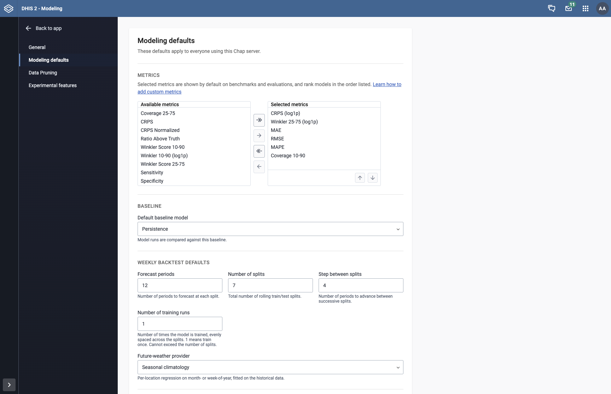
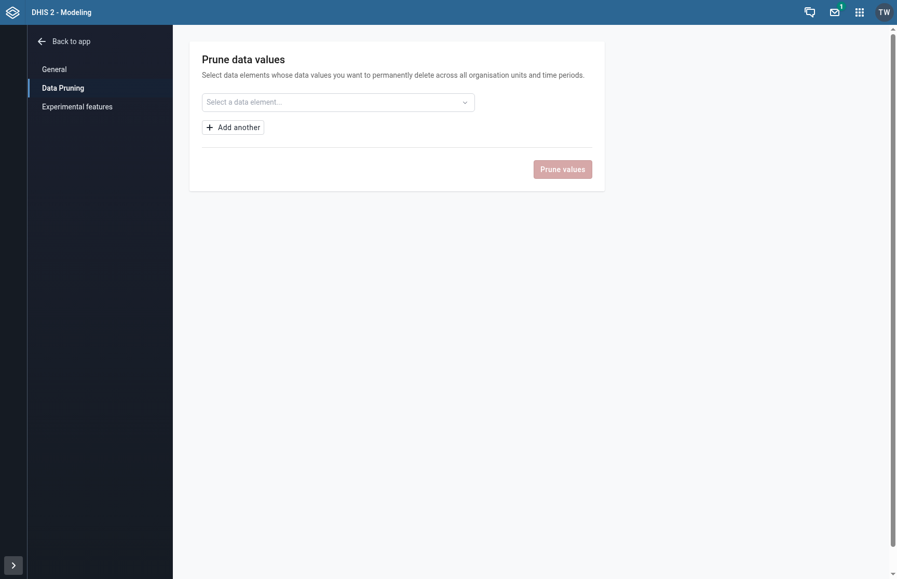
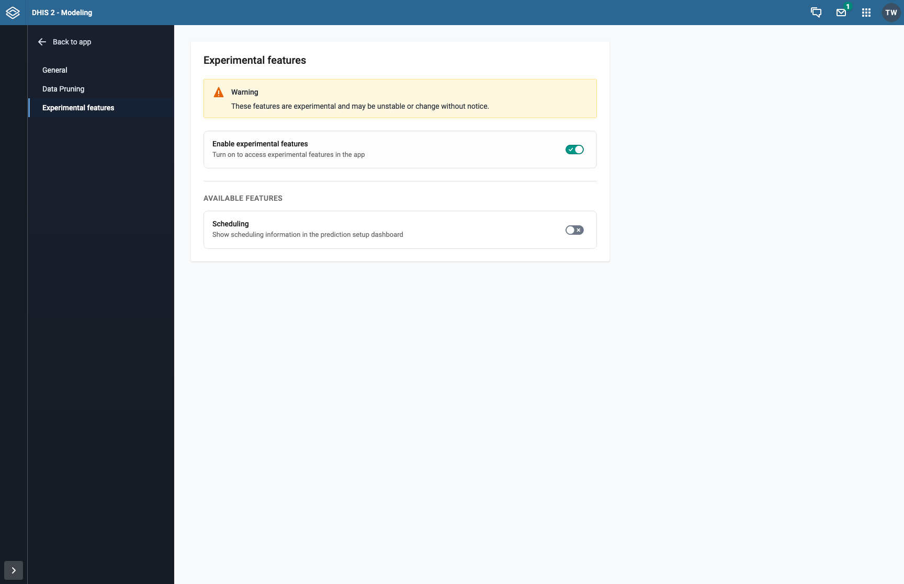

## Settings

The Settings area lets you configure how the Modeling App connects to your Chap backend, set modeling defaults, manage data, and enable experimental features. Open it by clicking **Settings** in the sidebar navigation.

Settings is divided into several sections, each accessible from the left-hand menu: **General** (route and Chap server), **Modeling defaults**, **Data Pruning**, and **Experimental features**.

---

### Step 1: Open the Settings Page

Click **Settings** in the sidebar to open the settings area. The General settings section is shown by default.

---

### Step 2: Configure the DHIS2 Route

The **Route settings** card manages the DHIS2 route that proxies requests to your Chap backend server.

If no route exists yet, click **Add route** and enter the URL of your Chap backend (for example, `https://chap.example.org/**`). If a route already exists, you will see its name, code, URL, and any assigned authorities.

To modify or delete an existing route, use the action buttons next to the route configuration header.

If Chap requires authentication, enter the server's `CHAP_API_TOKEN` in **Chap API token**. On DHIS2 2.40.7+, 2.41.4+, and 2.42+ the token is stored encrypted: as DHIS2 `api-token` authentication for Chap Core 2.5.0 and later, and as an encrypted Bearer header for older or not yet reachable Chap servers. Re-enter the token after upgrading Chap Core to switch to `api-token`. Leave the field blank when creating a route only if Chap does not require authentication.

Tokens saved through earlier versions of the Modeling App may be stored in plain text in the route's Authorization header. Upgrading does not migrate them automatically. Edit the route and re-enter the token to store it encrypted on a supported DHIS2 version. If it may have been exposed, rotate it on the Chap server and enter the new token. On older DHIS2 versions the Modeling App does not support setting API tokens, because DHIS2 could only store them in plain text; upgrade DHIS2 first. You can still remove an existing token there.

When editing a route with encrypted authentication, re-enter the token or explicitly remove it before saving, including when increasing the timeout. DHIS2 cannot preserve the encrypted credential during these updates, so saving replaces all encrypted authentication on the route, including custom headers.

> **Required permissions**: You need either the `F_ROUTE_PRIVATE_ADD` or `F_ROUTE_PUBLIC_ADD` authority in DHIS2 to create or edit routes. If you do not have these, contact your system administrator.

---

### Step 3: Review Route Warnings

After a route is configured, these warnings may appear:

- **API token stored in plain text**: Users who can read the route configuration can read the token. Replace it with encrypted authentication as described above.

- **Public access warning**: Shown when your route is publicly readable. This means any DHIS2 user can read the route configuration and reach the Chap backend, which could expose sensitive data. To restrict access, click the **Sharing** button and remove access for "All users".

- **Low response timeout warning**: Shown when the route's timeout is set below 10 seconds. Long-running model operations (evaluations, predictions) may fail with a low timeout. Click the **Increase to 30 seconds** button to apply the recommended setting.

---

### Step 4: Check the Chap Server Status

Below the route settings, the **Chap settings** card shows information about the connected Chap backend:

- **Chap Version**: The version of chap-core running on the server
- **Python Version**: The Python version on the server
- **Status**: A green "Connected" label confirms the app can reach the backend

If the connection fails, an error message is shown suggesting you verify your route configuration.

---

### Step 5: Set Modeling Defaults

Click **Modeling defaults** in the settings sidebar to choose the metrics, baseline model and backtest parameters that Chap uses unless you pick something else. The defaults are stored on the Chap server, so they apply to everyone using the same Chap server, from any DHIS2 instance connected to it.

> **Requirements**: Modeling defaults need a configured route (see Step 2) and Chap Core 2.6 or later. On older Chap Core versions the page explains that the server does not support modeling defaults, and the app keeps using Chap's built-in defaults.

#### Metrics

Move metrics between **Available metrics** and **Selected metrics**, and use the arrows to change their order. At least one metric must be selected.

- Evaluation results and benchmark tables show the selected metrics by default, in the order listed.
- The order also sets which metrics Chap treats as most important when comparing models, starting with the first one.
- Use the **Show all *N* metrics** button on an evaluation or benchmark to see the other metrics as well.

Chap ships with a set of standard metrics. To add your own, follow the **Learn how to add custom metrics** link in this section.

#### Baseline

Choose the **Default baseline model**. Model runs are compared against this baseline, for example to show whether a model does better than a simple reference forecast. Only models with the baseline role are listed.

#### Weekly and monthly backtest defaults

Weekly and monthly datasets have their own backtest defaults, because a sensible number of periods differs between the two. Each section has:

- **Forecast periods**, **Number of splits**, **Step between splits** and **Number of training runs**: The starting values for the backtest settings of a new evaluation. The number of training runs cannot be higher than the number of splits.
- **Future-weather provider**: The weather data used for the forecast periods. A warning is shown for providers that use observed future weather: their scores look better than the model would perform in practice, and they cannot be used for real predictions.

When you create an evaluation, the form starts from the weekly or monthly defaults to match the dataset's period type, and you can still change the values for that evaluation. Existing evaluations keep the parameters they were run with.

#### Saving

Click **Save changes** to store the defaults, or **Discard changes** to go back to the stored values. If you leave the page with unsaved changes, the app asks you to confirm before discarding them.

---

### Step 6: Prune Data Values

Click **Data Pruning** in the settings sidebar to access the data pruning tool. This is a **superuser-only** feature for permanently deleting data values generated by Chap.

1. Click the data element selector and choose a data element whose values you want to remove
2. Click **Add another** to add more data elements (up to 10)
3. Click **Prune values** to open the confirmation modal
4. Review the list of data elements to be pruned, type `delete` in the confirmation field and click **Delete**
5. A results summary shows how many data elements were pruned and lists any that failed

> **Warning**: Pruning permanently deletes all data values for the selected data elements across all organisation units and time periods. This action cannot be undone.

If you do not have superuser authority, **Data Pruning** is disabled in the settings sidebar.

---

### Step 7: Enable Experimental Features

Click **Experimental features** in the settings sidebar. Toggle the main **Enable experimental features** switch to turn on access to experimental functionality.

> **Required permissions**: You need the `F_CHAP_MODELING_APP` authority in DHIS2 to change experimental feature settings. If you do not have this authority, the toggles will be disabled and a notice will explain the required permission. Contact your system administrator to get access.

Once enabled, you can toggle individual features:

- **Scheduling**: Shows scheduling information in the prediction setup dashboard

Experimental features may change or be removed in future releases. Evaluation plots, including predicted vs actual, are available on the evaluation details page without enabling experimental features.

---

### Next Steps

After configuring your settings, you can:
- [Configure a model](/guides/configuring-a-model) to set up a model for evaluation or prediction
- [Create an evaluation](/guides/creating-an-evaluation) to test a model against your historical data
- [Create a prediction](/guides/creating-a-prediction) to generate forecasts for future periods
