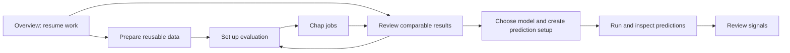
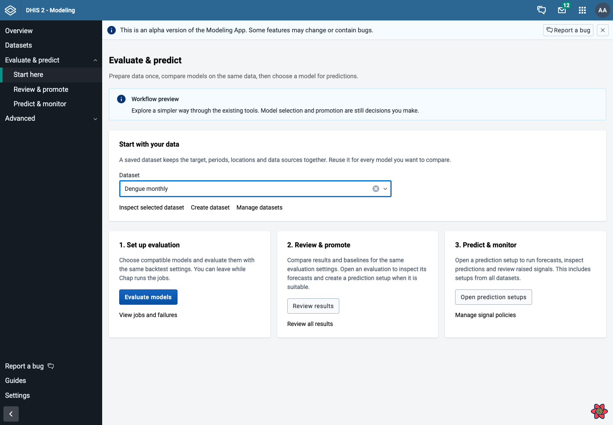

# Modeling workflow exploration · CLIM-1752

Status: proposal for the spike, not an agreed product design. This draft implements
the smallest useful frontend slice against the current Chap Core API. It does not
complete the epic's meeting, role decisions or implementation backlog.

## Starting point

[CLIM-1752](https://dhis2.atlassian.net/browse/CLIM-1752) asks for tasks instead of
one screen per database table. The [flow presentation](https://chap-sandbox.dhis2.org/learning-material/presentations/modeling-app-flow/#/1)
suggests two human tasks: set up a forecast, then review and promote. Automatic
configuration, tuning, notifications and recurring predictions in those mockups
are proposals, not capabilities this draft promises.

Keep **three areas in one app** initially. Splitting deployments, permissions and
shared state now would make the exploration harder. These are task boundaries,
not fixed user roles; one person may do all of them.

| Area | User's job | Existing building blocks |
| --- | --- | --- |
| Overview / app services | Resume work; find help; manage the connection and defaults | Dashboard, jobs, guides, settings |
| Datasets | Prepare and inspect reusable data: target, locations, periods, sources and missing values | Dataset creation, saved datasets, dataset details |
| Evaluate & predict | Try models, compare evidence, choose one, generate predictions and review signals | Dataset evaluation form, benchmarks, evaluation details, prediction setups and runs, signal review |

Within Evaluate & predict, separate **setup** from **review**, then expose
prediction operations as the next task. A reviewer should eventually enter a
specific set of results directly, without repeating data preparation.

## What this draft implements

- Overview links into a task-oriented start page at `#/workflow`.
- Navigation groups evaluation, review and prediction under Evaluate & predict.
  Model configuration, individual evaluations, arbitrary comparisons, signal
  policies and jobs remain available under Advanced. Existing deep links work.
- The start page chooses a saved dataset and keeps that choice in `datasetId` in
  the URL, so reload, back navigation and sharing retain it. Missing/deleted
  datasets cannot start an evaluation. Failed dataset reads offer a retry.
- Evaluate models opens the existing benchmark form with the dataset selected.
  It retains compatibility checks, defaults, model health checks, parameter
  validation, job submission and failure handling from `DatasetEvaluationForm`.
- Review results opens existing benchmarks filtered to that dataset. The dataset
  can have several benchmarks: comparison must stay within a specification,
  including target and backtest settings. Dataset identity alone is not enough.
- The shared dataset filter retains a linked selection while options load, even
  for datasets created by evaluations, so these deep links do not crash the page.
- Older servers without benchmarks use saved-dataset evaluation and the existing
  filtered evaluation list. This is a compatibility fallback, not a ranked review.
- The existing evaluation details screen remains the promotion point. The existing
  prediction setup screen leads to runs, forecasts and signal review.
- Prediction setups remain a global list, explicitly labeled as including all
  datasets. There is no extra request to fetch all evaluations just to infer a
  dataset filter, and no guessed link between a dataset and a prediction setup.

This is a navigation and context-handoff prototype. It does **not** yet remove all
the screens in the long flow. There is no new workflow store, API client, wizard,
ranking algorithm, browser-side job orchestrator or dependency. Try it with a
real saved dataset, then follow the existing forms and results through to a
prediction setup.

## Recommended next slices

1. **Review this prototype in the spike.** Walk through a new dataset, an existing
   dataset, a failed evaluation, and a different person reviewing results. Agree
   whether the three areas and two evaluation tasks match actual work. Capture
   conclusions in CLIM-1752 before filing implementation tickets.
2. **Finish the dataset handoff.** Reconcile [PR #353 / CLIM-1942](https://github.com/dhis2-chap/chap-frontend/pull/353),
   which removes the duplicate DHIS2 evaluation form. Return from creating or
   inspecting a dataset to the selected workflow. Keep advanced settings available
   but make sensible existing defaults the ordinary path. Do not duplicate forms.
3. **Build a focused review workspace.** Compose the current `BenchmarkTable`,
   metric descriptions, baseline comparisons and evaluation charts. Select a run
   in the same screen and reuse `MarkReadyForForecastingModal` and
   `useCreatePredictionSetup`. Preserve data-source and alert-policy validation.
   Provide a deep link to the benchmark and selected run for handoff.
4. **Automate setup in Chap Core.** Once the contract below is agreed, replace
   configured-model selection with template selection plus a default/tuning choice.
   Keep the same review and prediction screens. Show per-model progress, partial
   results and failures; users can leave and return without losing a run.
5. **Connect operations and handoff.** Show relevant setups and recent runs from
   a review, support notifications when results are ready, and make scheduling
   available only when the backend supports it. Connect to the existing signal
   review/early-warning experience rather than building another alert inbox.

Each slice should be independently reviewable. Reassess a separate dataset or
review app only if user research demonstrates different deployment or access
needs. Sharing components is already possible inside this repository. The shared
blocks migration in [draft PR #345](https://github.com/dhis2-chap/chap-frontend/pull/345)
can proceed independently; this draft reuses the current components directly.

## Current frontend / backend boundary

These are facts about the checked-in client and frontend, not a claim about every
Chap Core deployment. Capability checks remain authoritative for a running server.

| Task | Available now | Possible follow-up |
| --- | --- | --- |
| Prepare data | Saved dataset import and inspection; DHIS2 source mappings | Discover OCS/CAPS sources and import missing inputs |
| Choose candidates | Existing configured models filtered for dataset compatibility | Configure selected templates automatically from dataset semantics |
| Run evaluations | `createBacktests` returns specification/job IDs on Core 2.4+; single-model fallback | Durable parent run encompassing preparation, optional tuning and evaluation |
| Compare evidence | Specifications, metric direction/targets, baselines and run details | Focused review layout; agreed ranking and readiness criteria |
| Promote | Prediction setup references the evaluated backtest; existing modal validates inputs | Explicit reviewer decision/provenance if required |
| Predict and review | Prediction setup/run pages, policies and signal review with version gates | Scheduling and notifications with clear server capabilities |

### Chap Core discussion: automatic configuration and HPO

Do not add fake HPO controls or run tuning loops in the browser. First agree on
the smallest server-owned contract with the Chap Core team:

- **Input:** immutable dataset/version, target, candidate template versions,
  resolved evaluation specification, and either defaults or bounded tuning.
  Reuse existing entities/IDs where they already express this; a new entity is
  only needed for state that cannot be represented today.
- **Cost:** defaults should be the initial ordinary path. Tuning needs an explicit
  trial/time/concurrency budget, cancel behavior and clear resource limits.
- **Progress:** one durable run ID with stages and per-candidate jobs, failure
  reasons, retry/cancel semantics and partial results. Submission should be
  idempotent; refreshing a tab must not duplicate work. Existing job UI can render
  the child jobs. Parent execution belongs on the server.
- **Output:** specification ID, resulting configured-model versions, backtest IDs,
  tuning provenance and metric/baseline evidence. The review must work even if a
  candidate fails; do not silently treat a missing score as a winner.
- **Evaluation validity:** define the training/validation split used by tuning and
  keep held-out evaluation periods separate. Record dataset identity, split,
  parameters, seed and template revision. CLI-tuned configs need compatible
  provenance and overlap checks before being presented as clean comparisons.
- **Selection:** agree which metrics determine ranking, their directions/targets,
  ties and comparison with baselines. Reuse metric metadata and existing ranking
  helpers; no universal "best model" or automatic promotion in the frontend.
- **Handoff:** decide who receives completion notifications and through which
  service. A notification points to persistent results. It must not be necessary
  to keep the setup tab open. Delivery needs backend support.

The OCS/CAPS boundary, ownership of source metadata and cross-app terminology
belong in [CLIM-1619](https://dhis2.atlassian.net/browse/CLIM-1619), as the epic
specifies. Raise the setup screen's requirements there rather than deciding those
boundaries in this frontend branch. Keep "configured model" terminology until
the proposed "modeling package" naming is agreed.

## Feedback needed before implementation tickets

- Who prepares data, reviews evidence and monitors predictions? Which actions need
  different authorities, and can the same person perform all three tasks?
- Should a dataset represent a frozen snapshot or a refreshable source recipe?
  How should a new snapshot relate to earlier evaluations and promoted setups?
- Is benchmark/specification the right review unit, or must one submitted batch
  stay identifiable even when it shares a specification with previous runs?
- What makes a model suitable for use: metric thresholds, baseline improvement,
  operational review, or a combination? Who records that decision?
- Are predictions manual by default? Who owns scheduling, notification delivery
  and the handoff to the early-warning app?

## Validation scope

Two focused Playwright scenarios cover dataset handoff into the real existing
forms/results and dataset error/retry/stale-link behavior. Fixture data is created
through the existing evaluation helper; only the failed read is simulated.
Existing tests continue to cover evaluation submission, benchmark metrics,
promotion, prediction runs and signal review. Run lint, type checking, unit tests
and a production build alongside the focused browser tests.

Validated locally on 23 November 2026 with Chap Core 2.9.0.dev0: both new
scenarios and the existing benchmark-actions scenario pass; 344 unit tests pass
(two existing integration tests skipped); lint, monorepo type checking and the
modeling app production build pass. The benchmark test's origin expectation now
uses the fixture's returned flag, since the helper imports a saved dataset before
evaluating it. Older-server fallback remains to be exercised on a matching stack.

Before promoting this draft, agree the flow in the spike and reconcile PR #353.
The epic remains open until its meeting, agreed target flow and follow-up tickets
are recorded.
