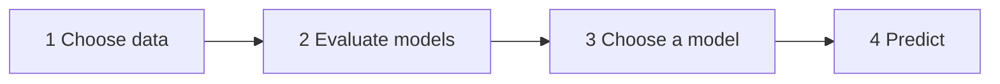
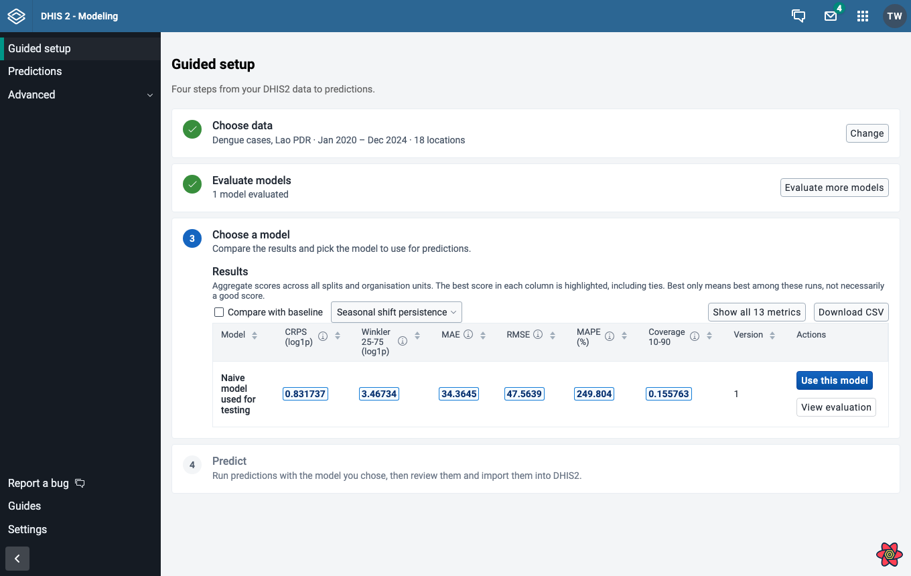

# Guided setup · CLIM-1752

Status: exploration for the spike, not an agreed design. It runs against the current
Chap Core API and adds no backend automation.

## Problem

[CLIM-1752](https://dhis2.atlassian.net/browse/CLIM-1752) asks for an app built around
what people need to do, not one screen per Chap Core table. Getting a first prediction
today means finding your way through Datasets, Evaluations, Benchmarks, Models and
Prediction setups, in the right order, and learning what each of them is.

A first attempt added a start page with links into those screens. It showed the order,
but every link still dropped the user into a full screen with its own vocabulary and no
way back to the thread, and the page looked the same whether nothing or everything was done.

## The idea: one page, four steps, each done in place

| Step | The user | Left out of the simple path |
| --- | --- | --- |
| 1 Choose data | Picks data they imported, or imports it from DHIS2. The import starts with the columns that let the most models run, so only the DHIS2 data items are left to pick. | Dataset list, origin filter |
| 2 Evaluate models | Picks models that can use the data and starts the evaluation. | Run name, target column, backtest parameters (Chap's defaults are used) |
| 3 Choose a model | Sees the results as they arrive and clicks **Use this model**. | Benchmark and specification as concepts, the evaluation list |
| 4 Predict | Runs a prediction, or opens the prediction setup to review signals and import into DHIS2. | Nothing new: this hands over to the existing prediction setup |

A finished step folds into one line with its result. There is one obvious next action at
any time, and a finished step can be opened again (other data, more models, compare again).

The sidebar follows the same split: **Guided setup**, **Predictions**, and everything
else under a collapsed **Advanced** group. Existing URLs keep working, and the group
opens by itself when you are on one of its pages.

## What keeps it small

- **No workflow state.** The page reads its progress from what Chap already has for the
  chosen dataset: the newest evaluation of it, the runs in that evaluation, and the
  prediction setup made from one of them. So it resumes on reload, on another machine and
  for another person. Only `datasetId` is in the URL.
- **No new forms.** The steps reuse the dataset import form, the model picker, the results
  table, the prediction setup dialog and the prediction form. The detailed screens are the
  same components with every option showing.
- **No new API.** The guided setup needs the evaluation endpoints from Chap Core 2.4.0.
  Older servers do not show it and keep the dashboard as their start page.

## Not in this exploration

- Automatic model configuration and tuning. Step 2 still lists configured models. If Chap
  Core gets a job that configures and tunes templates, step 2 becomes "pick templates" and
  the rest of the page stays as it is.
- Roles. The page works the same for whoever opens it; a reviewer can be sent the link and
  lands on the step that is waiting.
- Notifications when an evaluation finishes, and scheduling of predictions.
- A dataset with several evaluations shows the newest one. The others are under Advanced.

## Open questions for the spike

- Is the guided setup the right landing page, also for people who only run predictions?
- Should step 2 preselect models? Nothing in the model catalog says which to recommend.
- The detailed pages say "benchmark" where the team terminology says "evaluation".
  Renaming them is a separate change.
- The user guides and their screenshots still describe the old sidebar.
- [PR #353](https://github.com/dhis2-chap/chap-frontend/pull/353) changes the evaluation
  form that step 2 links to for its settings; whichever merges second needs a small rebase.

## Validation

One Playwright scenario walks the whole path against a real DHIS2 and Chap Core: import
data on the page, evaluate a model, choose it, reload, and open the prediction form.
