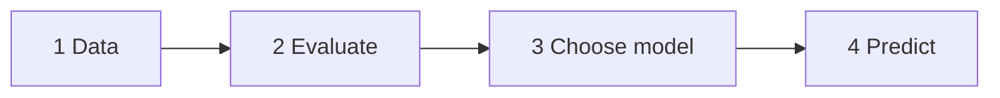
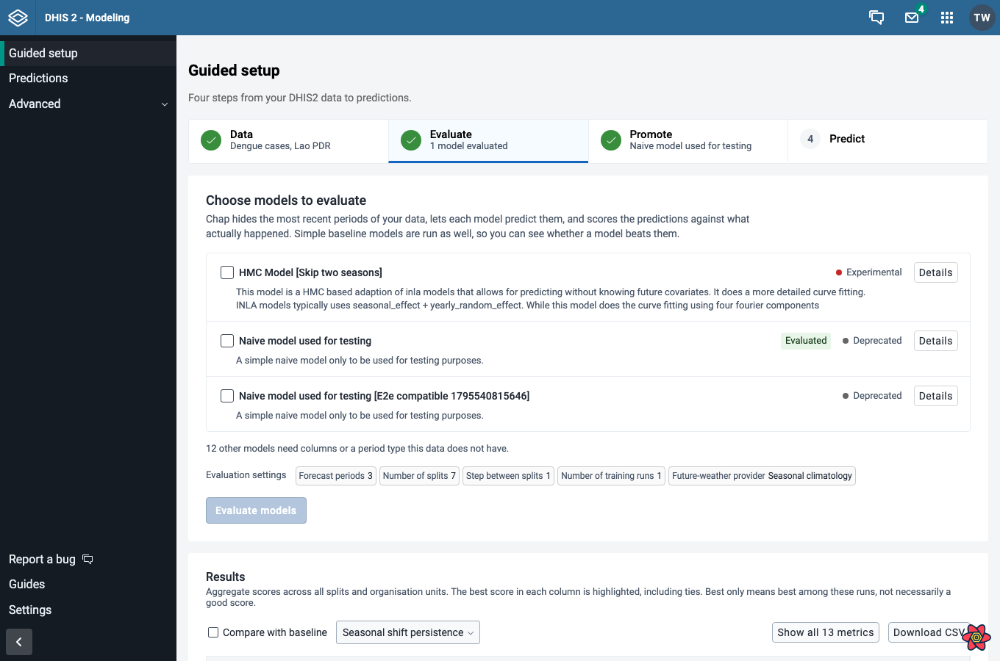
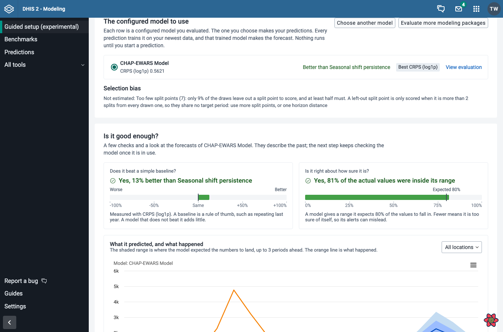
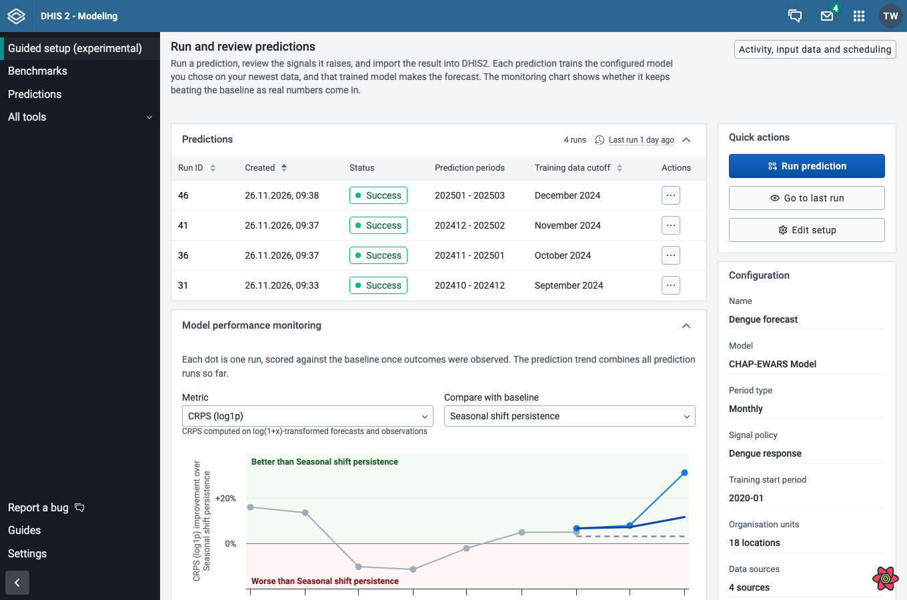

# Guided setup · CLIM-1752

Status: exploration for the spike, not an agreed design. It is in the menu as
**Guided setup (experimental)**, so people can try it and say what works; the pages it
builds on are unchanged and still under **All tools**.

## Problem

[CLIM-1752](https://dhis2.atlassian.net/browse/CLIM-1752) asks for an app built around
what people need to do, not one screen per Chap Core table. Getting a first prediction
today means finding your way through Datasets, Evaluations, Benchmarks, Models and
Prediction setups, in the right order, and learning what each of them is.

A first attempt added a start page with links into those screens. It showed the order,
but every link still dropped the user into a full screen with its own vocabulary and no
way back to the thread, and the page looked the same whether nothing or everything was done.

## The idea: four steps, one page each

A bar across the top shows the four steps, which are done and what each produced. Each
step is a page of its own with room for what it needs, and one button to continue.

| Step | The user | Left out of the simple path |
| --- | --- | --- |
| 1 Data | Imports data from DHIS2 to start a setup. The import starts with the columns that let the most models run, so only the DHIS2 data items are left to pick. Coming back to the step shows the data of the setup; other data is a setup of its own, opened from the overview or started new. | Dataset list, origin filter |
| 2 Evaluate | Picks modeling packages in a list that shows what each one is, keeps or changes the configuration of each, and starts the evaluation. Results appear on the same page as models finish. | Run name, target column, baseline models (Chap runs them anyway). The evaluation settings start from Chap's defaults and can be changed. |
| 3 Choose model | Chooses the configured model that will make the predictions and sees whether it can be trusted, then the signal policy that turns predictions into signals for review, and where results go in DHIS2. | Benchmark and specification as concepts, the full metric table |
| 4 Predict | Runs predictions, opens a run to review its signals and import it into DHIS2, and watches the model against the baseline as real numbers come in. | Activity, input data checks and scheduling, one click away |

| | |
| --- | --- |
|  |  |
|  |  |

Choosing the model is a step of its own because it is the decision in the flow: before it
you are trying models, after it one of them produces predictions that people act on.
Signals are set up there, in view, instead of in a dialog behind a button.

### Three words for "model"

"Model" means three things on the way to a forecast, and the titles, labels and
descriptions of the steps use one word for each. A strip that showed the three on every
step was tried and taken out again as too much:

- **Modeling package**: a forecasting method with its choices still open. Picked on Evaluate.
- **Configured model**: a modeling package with its configuration (settings and
  covariates) chosen. It is what gets evaluated, compared and chosen.
- **Trained model**: a configured model trained on your data. It makes each forecast.

### Model configuration, and tuning it

The steps say "model configuration" for what is often called hyperparameters, a word
people reacted to when the flow was shown. Each modeling package picked on the Evaluate
step is evaluated with its default configuration unless the user picks another configured
model of the package, sets a configuration of their own, or lets Chap tune it. Tuning is
marked experimental. Chap tries a number of configurations, scores each on the periods the
evaluation trains on, and evaluates the best one as a new configured model, next to the
default so the gain is visible. It needs Chap Core 2.9.0 and a modeling package that says
what can be tuned (`hpo_search_space` in its MLproject); where either is missing, the
choice is shown but cannot be picked.

### Trusting a model, before and after it is put to use

The Choose model step answers two questions in plain words, each with a bar, and shows
one chart:

- **Does it beat a simple baseline?** How much better or worse than the default baseline
  model on the ranking metric. A model that does not beat a rule of thumb adds little.
- **Is it right about how sure it is?** The share of actual values that fell inside the
  range the model gave, against the 80% it should be.
- **What it predicted, and what happened.** Every evaluated period in one chart, for all
  locations or one, with the count of periods where what happened was inside the range.
  Each period keeps the forecast made longest before it, so the chart does not flatter.

Under the list of evaluated models, and under the table of a benchmark, a **Selection
bias** summary says what to expect of the best model on new data, in four numbers: the
best model, how it compares with the baseline in the evaluation, how much of that is
estimated to be luck, and what is left. The best of several models always looks a little
better than it is. Chap draws the splits of the evaluation again some two thousand times
(a bootstrap over its split points) and picks the best model each time; the bias comes
from the draws that pick another model. No model is run again, and no model has to be
chosen first: the numbers are about the best one, whichever one is chosen. It needs Chap
Core 2.9.0, at least two evaluated models and enough splits to score every period ahead,
as the scores the models are ranked by do: 9 splits with two periods ahead and 20 with
three. With the default seven splits the summary says that it could not be estimated, and
why.

These are the questions the evaluation webinars teach, and the chart follows the forecast
band and model-against-baseline blocks in
[chap-blocks](https://github.com/dhis2-chap/chap-blocks). Nothing is hidden: the full
metric table is on the Evaluate step and every plot is behind **View evaluation**.

An evaluation only describes the past, so the Predict step keeps the question open: the
existing monitoring chart scores each prediction run against the baseline once the real
numbers are in, in a "better than" or "worse than" zone.

A first version of this idea put all four steps on one page as an accordion. It kept the
thread, but squeezed model selection and results into a panel and hid the choice of model and
signals in a dialog.

The sidebar follows the same split: **Guided setup (experimental)**, **Benchmarks**,
**Predictions**, and everything else under a collapsed **All tools** group. Existing URLs
keep working, and the group opens by itself when you are on one of its pages.

## What keeps it small

- **No workflow state.** The pages read their progress from what Chap already has for
  the chosen dataset: the newest evaluation of it, the runs in that evaluation, and the
  prediction setup made from one of them. So `#/guided` opens on the step that is waiting,
  also on another machine and for another person. Only `datasetId` is in the URL.
- **No new forms.** The steps reuse the dataset import form, the results table, the
  prediction setup fields (now shared between the dialog and the Choose model page), the
  signal policy dialog and the prediction setup widgets. The detailed screens are the
  same components with every option showing.
- **No API of its own.** The guided setup needs the evaluation endpoints from Chap Core
  2.4.0. Older servers do not show it and keep the dashboard as their start page. Tuning
  and the selection bias summary use what Chap Core 2.9.0 adds and are left out before that.

## Not in this exploration

- Configuring every modeling package automatically. Tuning is a choice per modeling
  package, and what it tried (the sets and their scores) is not shown, since Chap Core
  does not return it yet.
- Roles. The steps work the same for whoever opens them; a reviewer can be sent the link
  and lands on the step that is waiting.
- Notifications when an evaluation finishes, and scheduling of predictions.
- A setup that joins the dataset and the evaluation settings into one thing. Today a setup
  is a dataset, and its evaluation settings are chosen on the Evaluate step.

## Open questions for the spike

- Is the guided setup the right landing page, also for people who only run predictions?
- Should step 2 preselect models? Nothing in the model catalog says which to recommend.
- Should choosing a model that fails a check need a confirmation? Today the checks inform
  and do not block.
- Is the guided setup the start page while it is experimental, or a menu entry next to the
  menu people know?
- The detailed pages say "benchmark" where the team terminology says "evaluation".
  Renaming them is a separate change.
- The user guides and their screenshots still describe the old sidebar.

## Validation

One Playwright scenario walks the whole path against a real DHIS2 and Chap Core: import
data, evaluate a model, read the trust checks, choose it with a signal policy, come back
to `#/guided` and land on the prediction step with monitoring. A second checks the start
page on new and old servers. The series behind the forecast chart, the selection
bias summary and the names of configured models are unit tested. Tuning was tried against a
Chap Core with the tuning endpoint up to the point where the job is queued; no tuning run
has been taken to its end from the app.
