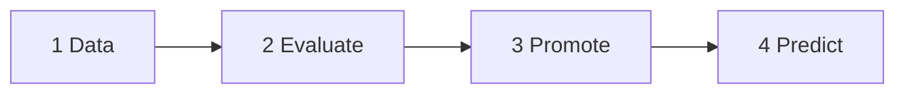
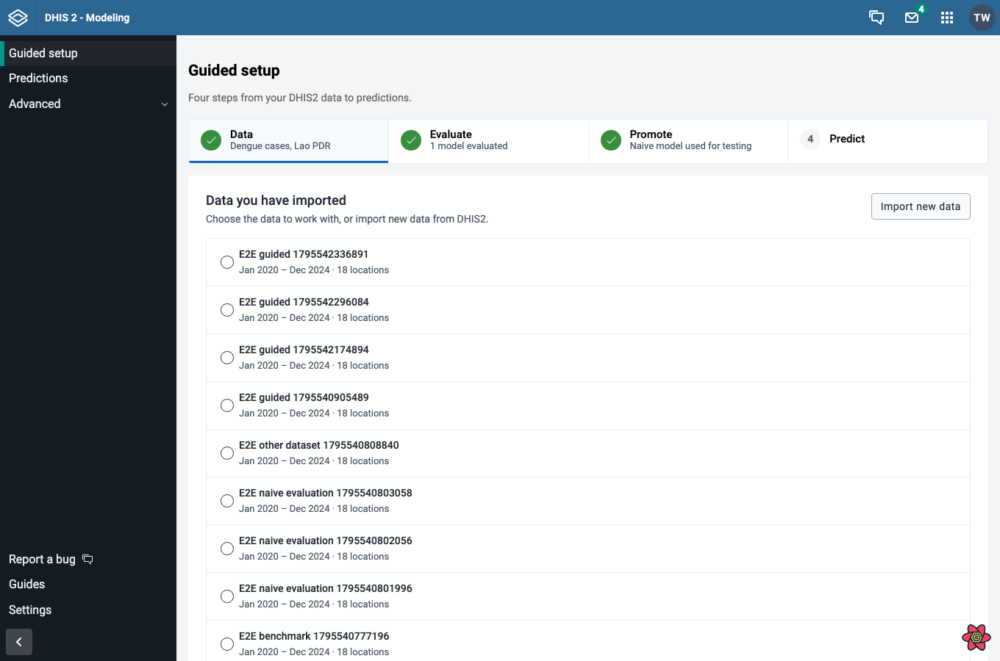
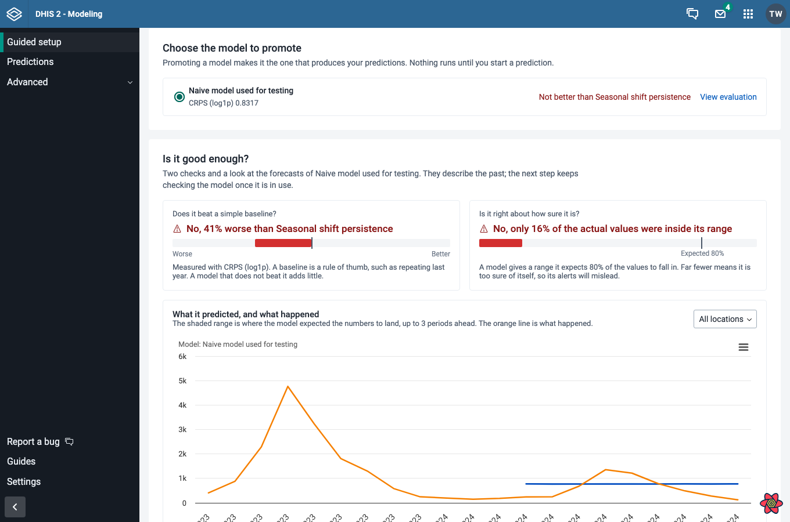

# Guided setup · CLIM-1752

Status: exploration for the spike, not an agreed design. It runs against the current
Chap Core API and adds no backend automation.

## Problem

[CLIM-1752](https://dhis2.atlassian.net/browse/CLIM-1752) asks for an app built around
what people need to do, not one screen per Chap Core table. Getting a first prediction
today means finding your way through Datasets, Evaluations, Benchmarks, Models and
Prediction setups, in the right order, and learning what each of them is.

A first attempt added a start page with links into those screens. It showed the order,
but every link still dropped the user into a full screen with its own vocabulary and no
way back to the thread, and the page looked the same whether nothing or everything was done.

## The idea: four steps, one page each

A bar across the top shows the four steps, which are done and what each produced. Each
step is a page of its own with room for what it needs, and one button to continue.

| Step | The user | Left out of the simple path |
| --- | --- | --- |
| 1 Data | Picks data they imported, or imports it from DHIS2. The import starts with the columns that let the most models run, so only the DHIS2 data items are left to pick. | Dataset list, origin filter |
| 2 Evaluate | Ticks models in a list that shows what each one is, and starts the evaluation. Results appear on the same page as models finish. | Run name, target column, backtest parameters (Chap's defaults are shown, not asked for), baseline models (Chap runs them anyway) |
| 3 Promote | Chooses the model that will make the predictions and sees whether it can be trusted, then the signal policy that turns predictions into signals for review, and where results go in DHIS2. | Benchmark and specification as concepts, the full metric table |
| 4 Predict | Runs predictions, opens a run to review its signals and import it into DHIS2, and watches the model against the baseline as real numbers come in. | Activity, input data checks and scheduling, one click away |

| | |
| --- | --- |
|  |  |
|  |  |

Promotion is a step of its own because it is the decision in the flow: before it you are
trying models, after it one of them produces predictions that people act on. Signals are
set up there, in view, instead of in a dialog behind a button.

### Trusting a model, before and after promotion

Choosing a model on the Promote step answers two questions in plain words, each with one
bar, and shows one chart:

- **Does it beat a simple baseline?** How much better or worse than the default baseline
  model on the ranking metric. A model that does not beat a rule of thumb adds little.
- **Is it right about how sure it is?** The share of actual values that fell inside the
  range the model gave, against the 80% it should be.
- **What it predicted, and what happened.** Every evaluated period in one chart, for all
  locations or one, with the count of periods where what happened was inside the range.
  Each period keeps the forecast made longest before it, so the chart does not flatter.

These are the questions the evaluation webinars teach, and the chart follows the forecast
band and model-against-baseline blocks in
[chap-blocks](https://github.com/dhis2-chap/chap-blocks). Nothing is hidden: the full
metric table is on the Evaluate step and every plot is behind **View evaluation**.

An evaluation only describes the past, so the Predict step keeps the question open: the
existing monitoring chart scores each prediction run against the baseline once the real
numbers are in, in a "better than" or "worse than" zone.

A first version of this idea put all four steps on one page as an accordion. It kept the
thread, but squeezed model selection and results into a panel and hid promotion and
signals in a dialog.

The sidebar follows the same split: **Guided setup**, **Predictions**, and everything
else under a collapsed **Advanced** group. Existing URLs keep working, and the group
opens by itself when you are on one of its pages.

## What keeps it small

- **No workflow state.** The pages read their progress from what Chap already has for
  the chosen dataset: the newest evaluation of it, the runs in that evaluation, and the
  prediction setup made from one of them. So `#/guided` opens on the step that is waiting,
  also on another machine and for another person. Only `datasetId` is in the URL.
- **No new forms.** The steps reuse the dataset import form, the results table, the
  prediction setup fields (now shared between the dialog and the Promote page), the
  signal policy dialog and the prediction setup widgets. The detailed screens are the
  same components with every option showing.
- **No new API.** The guided setup needs the evaluation endpoints from Chap Core 2.4.0.
  Older servers do not show it and keep the dashboard as their start page.

## Not in this exploration

- Automatic model configuration and tuning. Step 2 still lists configured models. If Chap
  Core gets a job that configures and tunes templates, step 2 becomes "pick templates" and
  the other steps stay as they are.
- Roles. The steps work the same for whoever opens them; a reviewer can be sent the link
  and lands on the step that is waiting.
- Notifications when an evaluation finishes, and scheduling of predictions.
- A dataset with several evaluations shows the newest one. The others are under Advanced.

## Open questions for the spike

- Is the guided setup the right landing page, also for people who only run predictions?
- Should step 2 preselect models? Nothing in the model catalog says which to recommend.
- Should promoting a model that fails a check need a confirmation? Today the checks inform
  and do not block.
- The detailed pages say "benchmark" where the team terminology says "evaluation".
  Renaming them is a separate change.
- The user guides and their screenshots still describe the old sidebar.

## Validation

One Playwright scenario walks the whole path against a real DHIS2 and Chap Core: import
data, evaluate a model, read the trust checks, promote it with a signal policy, come back
to `#/guided` and land on the prediction step with monitoring. A second checks the start
page on new and old servers. The series behind the forecast chart is unit tested.
